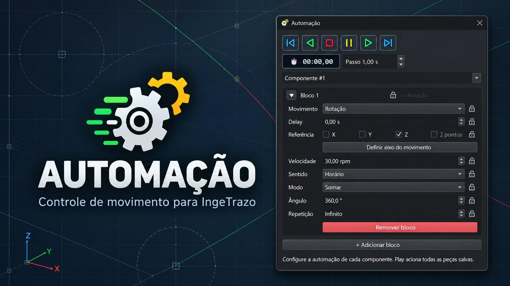
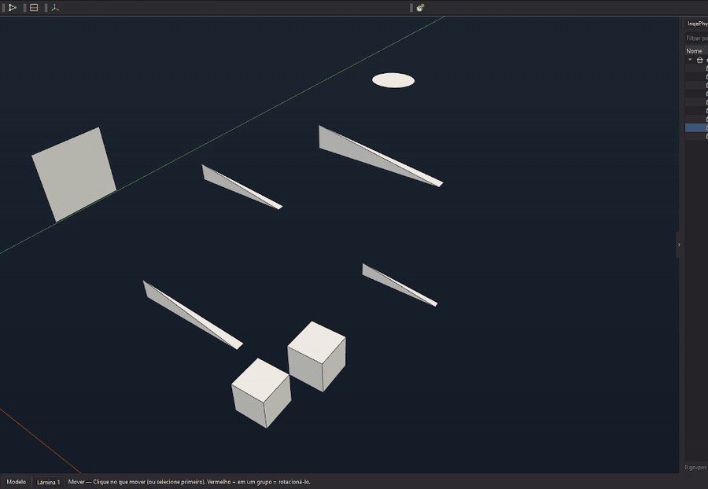

# Automação para IngeTrazo

Automação cinemática por componente para IngeTrazo 0.5.8 ou superior com API de extensões 2.

Cada peça pode ter vários blocos de movimento. A prévia é desenhada no viewport sem gravar transforms animados no modelo; **Stop** sempre volta as peças à posição inicial.

> Idiomas: [Português](README.md) · [English](README.en.md) · [Español](README.es.md)





## Destaques

- Rotação em torno de X, Y, Z ou de um eixo livre definido por dois pontos.
- Movimento linear entre A e B, com velocidade em mm/s, sentido e repetição.
- Modos lineares: **Soma**, **Ida** e **Ida + volta**.
- Delay por bloco, bloqueios por parâmetro e vários blocos por componente.
- Play, Play reverso, Pause, Stop, passo para frente/atrás e relógio de tempo corrente.
- Configurações gravadas no arquivo `.igz` e restauradas ao reabrir.
- Interface em português, inglês e espanhol, conforme o idioma do IngeTrazo.

## Instalação

1. Feche o IngeTrazo.
2. No IngeTrazo, abra **Extensões → Abrir pasta de plugins**.
3. Copie a pasta inteira `automacao` deste pacote para essa pasta de plugins.
4. Reinicie o IngeTrazo.

Não copie `automacao-debug.log`, `__pycache__` nem arquivos `.backup_*`.
O ZIP da release contém somente a pasta instalável `automacao`.

## Uso rápido

1. Abra **Automação** e selecione uma peça.
2. Clique em **Adicionar bloco** e escolha Rotação ou Deslocamento linear.
3. Escolha X, Y ou Z; para um eixo livre, clique em **Definir eixo do movimento** e marque A e B no viewport. Ao concluir B, **2 pontos** é selecionado automaticamente.
4. Ajuste velocidade, sentido, modo, distância/ângulo e repetição.
5. Use Play para executar todos os componentes salvos. O relógio mostra o tempo da prévia; Stop a reinicia.

### Modos de deslocamento linear

| Modo | Resultado por repetição |
| --- | --- |
| **Soma** | Continua avançando na direção selecionada a cada repetição. |
| **Ida** | Move de A para B e reinicia em A para a próxima repetição. |
| **Ida + volta** | Move de A para B e retorna a A. |

## Limites

- É uma prévia cinemática: não calcula colisões, engrenamento, física ou vínculos entre peças.
- Teste novamente ao atualizar o IngeTrazo, pois a extensão usa a API do viewport.
- O eixo por dois pontos requer pontos diferentes na mesma peça selecionada.

## Verificação antes de publicar uma demonstração

O roteiro completo está em [docs/TESTES-DE-RELEASE.md](docs/TESTES-DE-RELEASE.md). Para o GIF, use o roteiro compacto em [docs/GUIA-DO-GIF.md](docs/GUIA-DO-GIF.md).

## Estrutura do pacote

```text
automacao/
  __init__.py
  icone_motor.svg
  icone_cadeado_aberto.svg
  icone_cadeado_fechado.svg
  icone_passo_atras.svg
  icone_passo_frente.svg
  icone_pause.svg
  icone_play_reverso.svg
  icone_play.svg
  icone_stop.svg
README.md
README.en.md
README.es.md
CHANGELOG.md
LICENSE
catalog-draft.toml
verify_package.py
```

## Licença

MIT. Veja [LICENSE](LICENSE).
